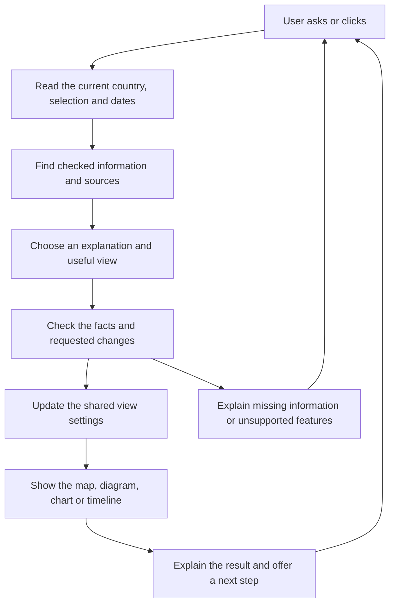

# How AI connects the user, information and screen

This guide describes the planned AI middleman for all [ten topics](README.md). It also explains what the current app can and cannot do.

## What each part does

- **The user** asks a question, chooses a topic or clicks something.
- **The information store** supplies checked facts, places, organizations, links, numbers, documents and sources.
- **AI** works out what the user needs, chooses a useful view and explains the facts.
- **The app** checks AI's requested changes and draws the supported views.

AI must use the information it finds. It must not make up locations, leaders, routes, statistics, powers or connections to fill a gap.



The app can show loading progress straight away. Answers and display changes must be based on information it has found.

## How AI handles a question

| Step                       | What happens                                                                                     |
| -------------------------- | ------------------------------------------------------------------------------------------------ |
| 1. Read the current view   | Check the selected country, area, item, topic and dates                                          |
| 2. Understand the question | Work out whether the user wants a place, explanation, comparison, connection or change over time |
| 3. Find the facts          | Load only the checked information needed for the answer                                          |
| 4. Check the match         | Make sure places, dates, definitions and units fit the question                                  |
| 5. Choose a view           | Pick a useful display and change only what is needed                                             |
| 6. Check and apply changes | Allow only valid commands, and let the user undo them                                            |
| 7. Explain                 | Give a short answer, point out limits and show sources                                           |
| 8. Continue                | Offer up to three useful follow-up questions                                                     |

Use information already on screen. Ask a short question only when a missing detail would change the answer, such as two places sharing the same name.

## Choosing what to show

| User asks                  | Useful view                  | Keep in mind                                             |
| -------------------------- | ---------------------------- | -------------------------------------------------------- |
| Where is it?               | Map                          | Show checked locations and explain approximate ones      |
| How is it organized?       | Organization diagram         | Keep independent bodies and different systems separate   |
| What is connected?         | Connection graph             | Explain each line, its direction and its source          |
| How does it work?          | Step-by-step process diagram | A process diagram does not prove a real route exists     |
| How much or how different? | Chart and table              | Match the meaning, units, area and dates                 |
| What changed?              | Timeline or chart over time  | Separate event dates from measurement and boundary dates |
| How do these fit together? | Map beside another view      | Keep the same selection and a readable amount of detail  |

If the current view already answers the question, AI can explain it without rearranging the screen.

## Questions and clicks should work together

- "Show the regions and explain who governs them" opens the available map areas and the relevant government information.
- Clicking a power-station dot opens its checked details and sources.
- "Who regulates it?" uses that selected station as the starting point.
- Panning the map, closing a panel or changing a filter works immediately.
- "Explain more" or "Give me a short quiz" starts the extra learning step when requested.

A click should open saved details without waiting for AI. Ask AI to explain them when the user requests it or has chosen a guided lesson.

## Getting the facts right

Link factual statements to their sources. Where needed, also identify the exact figure, table or document section. Explain the difference between a published fact, a calculation made by the app and AI's explanation.

When sources disagree, show what differs and keep their dates and definitions. Carry important warnings into saved views and reports. For example, an unclear boundary date must stay visible when that boundary is used.

Keep these differences clear:

- **Zero** means a measured value; **unavailable** means the value is missing.
- **No saved link** means the app has no evidence for it; the real-world link may still exist.
- **A census count** and **a later population estimate** are different measures.
- **A nearby facility** is not automatically the area's supplier or service provider.
- **A list of areas** does not show which government body controls another.
- **A law's publication date** may differ from the date it starts applying.

If information is missing, say so and offer a supported alternative. A future research tool may suggest new sources for review. AI must not add its own guesses as checked facts.

## Keeping the user in control

Before changing the screen, the planned AI controller should record:

- The question, topic, selected places and dates.
- The facts and sources it will use.
- The views and commands it needs.
- The view settings on which the answer depends.

These are planned additions. The app does not yet have this full plan format.

Check a group of related commands before applying it. If the user changes country or selection while AI is working, stop or update the old plan. Cancelling a request should also cancel its pending screen changes.

Keep the previous view usable if a request fails. Show a short retry option or another useful route.

AI sends a small list of allowed commands. It must not send code, database queries or arbitrary web addresses for the app to run.

### Example using existing commands

After checking the South African government information and confirming South Africa is selected, the app can use:

```json
[
  { "type": "OPEN_ENTITY", "payload": { "entityId": "za-government" } },
  { "type": "SET_VISUALIZATION_MODE", "payload": { "mode": "hierarchy" } },
  { "type": "EXPAND_NODE", "payload": { "nodeId": "za-government" } }
]
```

In plain terms: select the government entry, switch to its organization diagram and open its first level. The answer still needs facts and sources. Other countries use their own entry names and supported features.

## What the AI connection supports today

The current [AI connection code](../../lib/agent.ts) has four tools for finding information:

| Tool name                | What it does                           |
| ------------------------ | -------------------------------------- |
| search_knowledge         | Search entries in the selected country |
| get_entity_details       | Read one entry                         |
| get_entity_relationships | Read its saved connections             |
| get_dataset              | Read a supported collection of figures |

Its canvas_action tool allows seven commands: SELECT_COUNTRY, OPEN_ENTITY, SET_VISUALIZATION_MODE, EXPAND_NODE, FOCUS_REGION, CREATE_CHART and FIT_CANVAS.

Some app features are not yet connected to these AI tools:

- The AI view selector does not yet include Compare or History.
- The get_dataset tool currently reads the South African Census collections. Country comparison figures use a separate part of the app.
- Not all layer controls, connection tracing, layouts or comparison settings are available to AI.
- Document sections and learning activities need new tools.

The broader [command rules](../../lib/actions.ts) allow more actions than this AI connection exposes. A group can contain at most eight commands. Every new AI command needs a matching app feature and checks.

## What needs to be added

Give AI a short summary of relevant map settings, dates, selected connections and comparisons. Include a way to tell whether the user has changed the view since the request began.

For learning sessions, also keep the user's goal, chosen explanation level and completed steps. Load just the facts needed for the question instead of putting the whole country collection into every AI request.

Add tools for checking available topics, country divisions, country statistics, events and source passages. Connect new display commands only when the app can check and apply them.

AI keys remain planned for later. Basic controls and the labelled local guide should keep working as these parts are added.

## Guided lessons

A guided lesson can contain a question, a short explanation, one interaction, an optional quiz and a next step. Let users skip, change topic or return to free exploration.

Build questions and feedback from the lesson's sources. If the evidence is unclear, explain that rather than mark the user's answer wrong. Opinions and disputed explanations should not be treated as simple fact questions.

Progress can first be saved on the current device, separately from map undo history. A saved lesson should remember which version of the facts it used and flag later changes. Saving across accounts or devices is a separate future feature.

## How to check it

- Answers use checked facts and a suitable view, or clearly explain what is missing.
- Selecting an item in one view keeps the same item selected in another.
- Commands are checked and display changes can be undone.
- An old answer cannot change a newly selected country or place.
- Closing a panel keeps the map position, layers and selection.
- Basic exploration remains usable if AI is off or a request fails.
