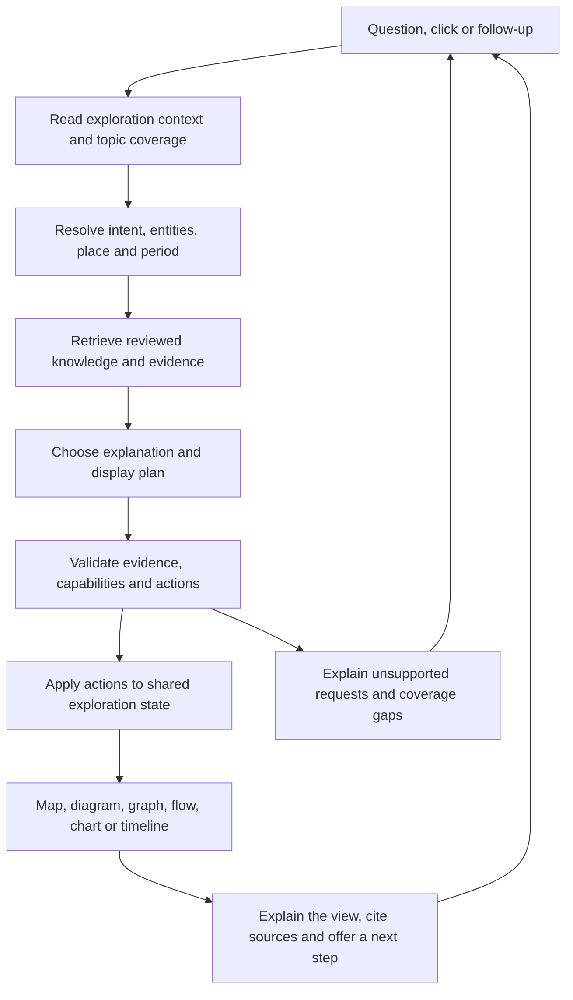

# AI between the user, knowledge and display

This is the proposed orchestration design for all [ten topics](README.md). Existing implementation limits are identified below.

## Responsibilities

The user supplies an interest, question or selection. The knowledge layer returns reviewed entities, relationships, observations, documents, geography and source metadata. AI interprets and connects that evidence, chooses a presentation and explains it. The application validates the plan and renders supported views.

AI does not become the source of country facts. It must not invent coordinates, officeholders, routes, statistics, legal powers or missing relationships to complete a diagram.



The diagram expresses logical dependencies. Loading feedback can stream immediately, but factual prose and display instructions must remain tied to retrieved evidence.

## The interaction loop

| Step                  | What AI or the application does                                                                         | What the user experiences                                    |
| --------------------- | ------------------------------------------------------------------------------------------------------- | ------------------------------------------------------------ |
| 1. Read context       | Inspect country, selected area/entity, active topic, time settings, current view and available coverage | "Here" and "this institution" refer to the current selection |
| 2. Resolve intent     | Distinguish locating, explaining, comparing, tracing, exploring change and learning a concept           | A useful interpretation of the question                      |
| 3. Retrieve           | Fetch bounded records and the evidence needed for the proposed answer                                   | Clear loading status; no invented completion                 |
| 4. Check suitability  | Verify geography, periods, definitions, identifiers and supported renderers/actions                     | Comparable values and correctly labelled boundaries          |
| 5. Plan               | Choose the smallest useful visual change and an explanation outline                                     | A relevant map, chart or diagram without unnecessary panels  |
| 6. Validate and apply | Reject invalid IDs, unsupported layers and stale plans; apply a bounded reversible action batch         | Predictable changes that can be undone                       |
| 7. Explain            | Describe what the visual shows, why it is relevant and what remains unknown                             | A short answer with inspectable citations                    |
| 8. Continue           | Offer up to three relevant follow-ups or respond to the user's next click                               | An exploration that follows curiosity                        |

Do not ask the user to repeat information already present in context. Ask a short clarifying question when ambiguity would materially change the evidence or display, such as which of two places with the same name they mean.

## Choosing a representation

| Intent                     | Default representation                     | Important qualification                                           |
| -------------------------- | ------------------------------------------ | ----------------------------------------------------------------- |
| Where?                     | Map and geographic selection               | Only verified spatial features or explicitly approximate locators |
| How is it organized?       | Hierarchy or grouped institutional diagram | Independent bodies and parallel schemes must remain distinct      |
| Who is connected to whom?  | Typed relationship graph                   | Edge direction, meaning and evidence remain inspectable           |
| How does a process work?   | System flow                                | An explanatory flow is distinct from a verified physical route    |
| How much or how different? | Chart and accessible table                 | Matching definitions, units, geography and comparable periods     |
| What changed?              | Timeline or time series                    | Event dates, observation dates and boundary editions are separate |
| How do these fit together? | Split map plus a focused secondary view    | Shared selection and a bounded amount of detail                   |

A request for an explanation does not always require changing the canvas. If the existing view already answers the question, explain it and preserve the user's arrangement.

## Questions and clicks work together

- **Question to canvas:** "Show the regions and explain who governs them" resolves the country's relevant schemes, focuses available geometry and opens a supported institutional view.
- **Canvas to explanation:** clicking a power-station dot selects its reviewed record. The details panel presents its evidence; AI can then explain documented ownership or the electricity system.
- **Follow-up in context:** "And who regulates it?" keeps the selected entity and retrieves the appropriate typed relationships.
- **Manual adjustment:** panning, closing a panel or changing a filter takes effect immediately. It does not require a model request.
- **Optional learning prompt:** the user can request a brief explanation, a deeper account, a source comparison or a knowledge check.

Clicking a dot must not automatically trigger an expensive model request for every selection. Open reviewed details immediately; invoke AI when the user requests an explanation or has enabled a guided session.

## Evidence and explanation

Each substantive claim should connect to one or more retrieved source records and, where needed, an exact observation or document passage. Separate a publisher's statement, an application's explicit calculation and an AI explanation of their implications.

When sources conflict, identify what differs and retain the source-specific dates or definitions. If a boundary file has an unresolved date conflict, the explanation must carry that caveat into charts, saved views and reports using it. Retrieval date must not replace an observation or effective date.

Never equate these conditions:

- A zero value and an unavailable value.
- A relationship not found in this catalogue and a relationship that does not exist.
- A census count and a later population estimate.
- A nearby facility and a documented supplier or service area.
- A reference-area directory and a government reporting line.
- A legal instrument's publication date and the date its provisions take effect.

If coverage is missing, explain the gap, show a supported alternative and allow the user to continue. Any future source-discovery feature should produce a reviewable ingestion candidate; it must not silently add model-generated claims to the reviewed catalogue.

## Plans, actions and shared state

A proposed internal display plan should record the resolved question, topics, country/area IDs, evidence IDs, chosen views, required capabilities, action sequence, explanation outline and the exploration revision on which it depends. This is a future planning interface, not an API that currently exists.

The application should validate the entire dependent batch before changing state. Reject or replan if the user changed country, selection or period while a response was loading. Cancelling a request must cancel its pending display changes. A failed plan should retain the previous usable view and provide a concise retry or alternative.

AI issues declarative commands. It never sends JavaScript, HTML, SQL, arbitrary URLs or direct store writes for execution.

For example, after retrieving the South African government root and confirming the active country, the following uses existing action names and identifiers:

```json
[
  { "type": "OPEN_ENTITY", "payload": { "entityId": "za-government" } },
  { "type": "SET_VISUALIZATION_MODE", "payload": { "mode": "hierarchy" } },
  { "type": "EXPAND_NODE", "payload": { "nodeId": "za-government" } }
]
```

This is a navigation example, not a complete lesson. An explanatory answer still needs retrieved evidence and citations. Other countries must resolve their own IDs and capabilities before a batch is constructed.

## Existing implementation and required extensions

The current [provider adapter](../../lib/agent.ts) exposes four read tools: search_knowledge, get_entity_details, get_entity_relationships and get_dataset. Its canvas_action tool exposes seven commands: SELECT_COUNTRY, OPEN_ENTITY, SET_VISUALIZATION_MODE, EXPAND_NODE, FOCUS_REGION, CREATE_CHART and FIT_CANVAS.

That adapter's mode enum currently omits compare and timeline, although the broader application supports them. Its get_dataset path currently retrieves the South African Census dataset collection; global indicators are handled separately in the application. Layer composition, tracing, layout changes, comparison settings, document passages and learning activities are not all available as provider tools.

The shared [action schema](../../lib/actions.ts) supports more actions than the provider adapter exposes, and permits at most eight actions in a batch. Extending the AI controller requires explicit tool contracts and tests; listing a feature in a prompt does not make it executable.

The current chat context includes country, domain, mode, selected entity, visible IDs and region. Extend it with a bounded representation of relevant time settings, layer state, layout, selected relationships, comparison settings and a revision token. Proposed learning-session context should add the current goal, explanation depth and completed steps without dumping full country catalogues into the model prompt.

Replace the current whole-index prompt approach with capability summaries and bounded retrieval as content expands. Future read tools should expose topic coverage, country schemes, indicators, dated events and cited document excerpts. Expose only validated display actions that the client can actually apply.

Live credentials and full orchestration remain deferred. Manual controls and the labelled local guide should continue to function while these extensions are developed.

## Guided learning

A proposed guided journey contains a question, a short explanation, a focused interaction, an optional check of understanding and a relevant next step. Let the user skip, change topic or return to free exploration at any time.

Questions and feedback must be generated from retrieved lesson evidence. If evidence is insufficient, do not grade the answer as wrong. Distinguish recalling a sourced fact from interpreting a complex or contested issue.

Learning progress can initially be optional browser-local state, separate from canvas undo history. A future saved journey should retain its evidence version and identify source changes when resumed. Account synchronization is a separate future feature.

## Acceptance criteria

- A question results in an evidence-backed explanation and an appropriate supported display, or an explicit coverage gap.
- A selected map entity remains the same entity in subsequent graph and explanation views.
- All proposed changes pass action and capability validation and can be undone.
- User navigation during loading cannot apply an answer to the wrong country or selection.
- Closing an overlay preserves the map and current selection.
- Core exploration works without a live model, and an AI error leaves manual controls usable.
